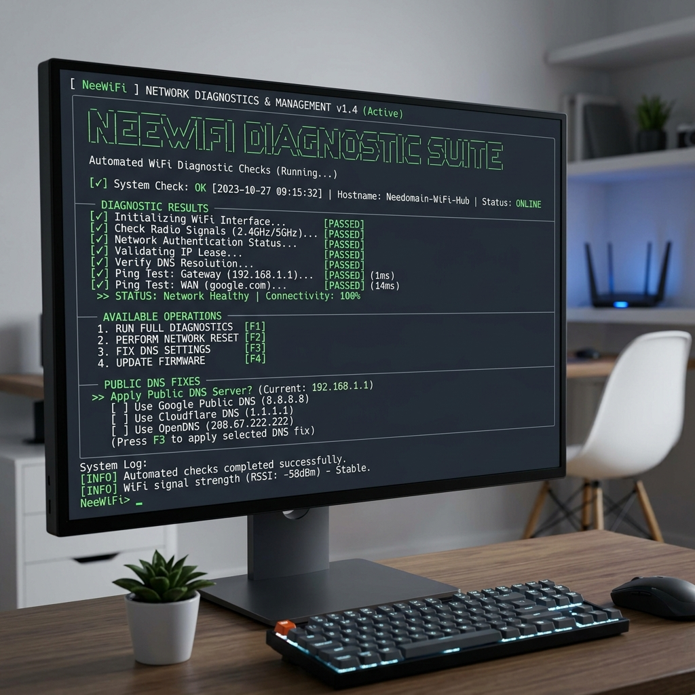

# NeeWiFi: Linux Wi-Fi troubleshooter

NeeWiFi is a root-required, interactive Python terminal utility for inspecting and repairing a subset of common Linux Wi-Fi problems. It is designed around NetworkManager, `rfkill`, the Linux network interface files under `/sys/class/net`, and standard networking commands. The current implementation is most relevant to Debian-, Ubuntu-, and Kali-style systems that provide those commands; it is not a general-purpose network manager or a daemon.



## What it currently does

On every menu loop, NeeWiFi runs a diagnostic pass that:

- finds likely wireless interfaces in `/sys/class/net` and reports interface state, MAC address, and kernel driver;
- checks reachability of `8.8.8.8`, DNS resolution via `google.com`, NetworkManager activity, and `rfkill` soft/hard blocks;
- reads the default gateway from `ip route` and pings it when available.

The interactive menu then offers:

1. run the diagnostic-driven auto-repair sequence;
2. scan nearby networks with `nmcli` (up to 15 results and a simple 2.4 GHz channel-count recommendation);
3. download 1 MB from Cloudflare to estimate download speed;
4. show matching Wi-Fi/firmware lines from `dmesg`;
5. display wireless adapter metadata;
6. restart NetworkManager;
7. run `rfkill unblock all`;
8. overwrite `/etc/resolv.conf` with `8.8.8.8` and `1.1.1.1`;
9. exit.

## Current limitations

- The program exits unless started as root, even for read-only diagnostics.
- It assumes Linux tools such as `ping`, `systemctl`, `rfkill`, `ip`, `nmcli`, `dmesg`, and `grep` are available. There is no `requirements.txt` or package installer in this repository; the only Python package imported by the script is [`rich`](https://pypi.org/project/rich/).
- Repairs are best-effort: command return codes are not surfaced consistently and the auto-repair path does not perform a fresh diagnostic pass before returning to the menu.
- Interface discovery is heuristic (`/sys/class/net/*/wireless`, `wlan*`, or `wlp*`), and the channel recommendation only considers channels 1, 6, and 11.
- DNS repair writes directly to `/etc/resolv.conf`. On systems managed by `systemd-resolved`, NetworkManager, or another resolver service, that file may be a symlink or be regenerated. NeeWiFi does not preserve or restore the previous contents.
- The speed test requires internet access and sends a 1 MB request to `https://speed.cloudflare.com`; its result is only a rough single-download estimate, not a complete network benchmark.

## Safety and privacy notes

Run this only on a machine you administer. It executes privileged commands that can restart networking, unblock radios, change interface state, read kernel logs, and overwrite resolver configuration. Inspect the menu choice before selecting a repair. Do **not** make `/etc/resolv.conf` immutable with `chattr +i`; that can prevent your operating system's resolver service from managing DNS and make later recovery harder. Back up or otherwise understand your resolver configuration before using option 8.

The adapter-details screen displays MAC addresses, and nearby-network scans display SSIDs and BSSIDs. Avoid sharing those outputs publicly. Option 3 contacts Cloudflare, and option 4 may expose host or driver information from kernel logs. No telemetry or background service is implemented by this repository.

## Quick start

```bash
git clone https://github.com/sudonishant/nee-wifi-fixer.git
cd nee-wifi-fixer
python3 -m venv .venv
. .venv/bin/activate
python -m pip install rich
sudo .venv/bin/python neewifi.py
```

The final command is required by the current `main()` implementation. If your distribution prevents system-wide `pip` installs, the virtual environment keeps `rich` isolated. The script itself does not read environment variables or require API keys.

## Architecture map

```text
main()
  ├─ run_diagnostics()
  │    ├─ get_wifi_details()       -> /sys/class/net
  │    ├─ check_internet()         -> ping 8.8.8.8
  │    ├─ check_dns()              -> ping google.com
  │    ├─ check_network_manager()  -> systemctl is-active NetworkManager
  │    ├─ check_rfkill()            -> rfkill list wifi
  │    └─ gateway checks            -> ip route + ping
  ├─ print_diagnostics_report()
  └─ menu actions
       ├─ apply_auto_repair()      -> rfkill/systemctl/ip/resolv.conf
       ├─ scan_wifi_networks()      -> nmcli
       ├─ run_speedtest()           -> Cloudflare HTTPS download
       ├─ view_system_logs()        -> dmesg/grep/tail
       └─ show_hardware_details()
```

`run_cmd()` is the shared subprocess helper. It uses a shell command, captures output, and applies an eight-second timeout; the speed test has its own ten-second URL timeout.

## Troubleshooting the setup

- **`ModuleNotFoundError: No module named 'rich'`**: activate `.venv` and run `python -m pip install rich`, then launch with `sudo .venv/bin/python neewifi.py`.
- **Permission or `Operation not permitted` errors**: confirm that the launch command uses `sudo`. A hard RF block still requires the laptop's physical switch or function key.
- **Missing command or service**: verify that `NetworkManager`, `nmcli`, `rfkill`, `iproute2`, `iputils-ping`, and the relevant system utilities are installed for your distribution.
- **DNS changes do not persist**: that is expected when a resolver service manages `/etc/resolv.conf`. Configure the active resolver service instead of locking the file.
- **No wireless adapter is shown**: check whether the kernel exposes the device and whether its driver/firmware is loaded; option 4 can show matching `dmesg` lines when permitted.

For the longer setup notes, see [`SETUP_GUIDE.md`](./SETUP_GUIDE.md). There are currently no automated tests in the repository; a syntax-only parse is a safe local check.

## License

Distributed under the MIT License.
