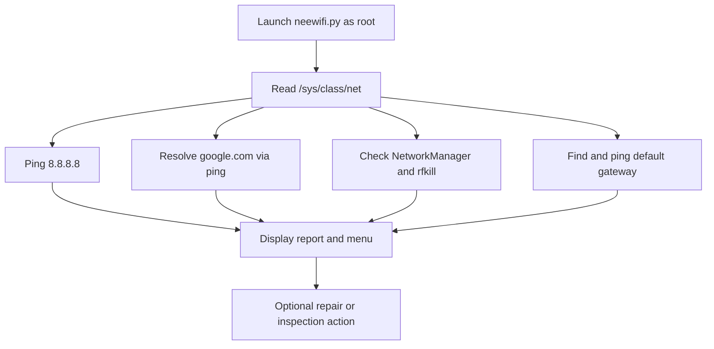

# NeeWiFi setup and troubleshooting guide

This guide covers installation, the commands NeeWiFi expects, and the host-level effects of its repair actions. NeeWiFi is an interactive Linux script, not a background service.

## 1. Before you run it

Use it only on a Linux machine you administer. The current entry point exits unless it is run as root, and repair options can restart NetworkManager, unblock all Wi-Fi radios, change interface state, and overwrite `/etc/resolv.conf`.

The script expects `python3`, `sudo`, `ping`, `systemctl`, `rfkill`, `ip`, `nmcli`, `dmesg`, `grep`, and `tail`. The repository has no dependency manifest; install the one imported Python package, `rich`, in a virtual environment:

```bash
git clone https://github.com/sudonishant/nee-wifi-fixer.git
cd nee-wifi-fixer
python3 -m venv .venv
. .venv/bin/activate
python -m pip install rich
sudo .venv/bin/python neewifi.py
```

If a distribution does not provide one of the system commands, install the corresponding package using that distribution's package manager. Do not run the tool against a remote or shared host unless you understand the consequences of each menu action.

## 2. Diagnostic flow



The diagnostic pass runs again when the menu loop starts. The script does not automatically verify repairs before returning to the menu.

## 3. Menu actions and side effects

- **1 — Deep Scan & Auto-Repair:** may run `rfkill unblock all`, restart NetworkManager, bring detected interfaces up with `ip link`, and write public DNS servers to `/etc/resolv.conf` when the corresponding checks indicate a problem.
- **2 — Scan Nearby Wi-Fi:** calls `nmcli device wifi list`, displays up to 15 networks, and shows SSIDs, BSSIDs, signal, channel, and security. It recommends among channels 1, 6, and 11 using only the observed count.
- **3 — Download speed test:** fetches 1 MB from `https://speed.cloudflare.com/__down?bytes=1000000`. This is an external request and a rough download estimate, not a full speed test.
- **4 — Kernel logs:** filters recent matching `dmesg` output for Wi-Fi and firmware terms. Kernel permission settings may prevent access.
- **5 — Adapter details:** displays interface name, MAC address, driver, state, and `/sys/class/net` path. Treat this output as identifying information.
- **6 — Restart NetworkManager:** restarts the service immediately.
- **7 — Unblock radios:** runs `rfkill unblock all`; it cannot override a physical hardware block.
- **8 — Reset DNS:** directly opens `/etc/resolv.conf` for writing and replaces it with `8.8.8.8` and `1.1.1.1`.
- **9 — Exit.**

## 4. DNS warning

`/etc/resolv.conf` may be a symlink or managed by `systemd-resolved`, NetworkManager, or another local resolver. Direct writes can be replaced, can disrupt local DNS search settings, or can fail. NeeWiFi does not save the old file or configure the service that owns it. Do not follow advice to run `chattr +i /etc/resolv.conf`: making the file immutable can block normal resolver updates and complicate recovery. Prefer configuring the active resolver service and keep a recovery path to the original configuration.

## 5. Common problems

### `ModuleNotFoundError: No module named 'rich'`

Activate the virtual environment and install the dependency, then use that environment's interpreter with sudo:

```bash
. .venv/bin/activate
python -m pip install rich
sudo .venv/bin/python neewifi.py
```

### `PermissionError`, `Operation not permitted`, or a blocked repair

Confirm that the final launch command uses `sudo`. A hard RF block still requires the device's physical switch or function key. A restricted `dmesg` is a kernel policy issue, not necessarily a Wi-Fi failure.

### No adapter appears

The implementation detects wireless devices by `/sys/class/net/*/wireless` or names beginning with `wlan`/`wlp`. Check that the kernel driver and firmware are loaded and that the interface is visible to the operating system.

### DNS repair does not persist

This is expected when another service owns `/etc/resolv.conf`. Configure that service rather than locking the file or repeatedly overwriting it.

## 6. Safe scope

There are no automated tests or CI workflows in this repository. Before running on a real host, review the menu action descriptions above and start with read-only inspection where possible. The repository's Python entry point is `neewifi.py`; there are no environment variables or API keys required.
