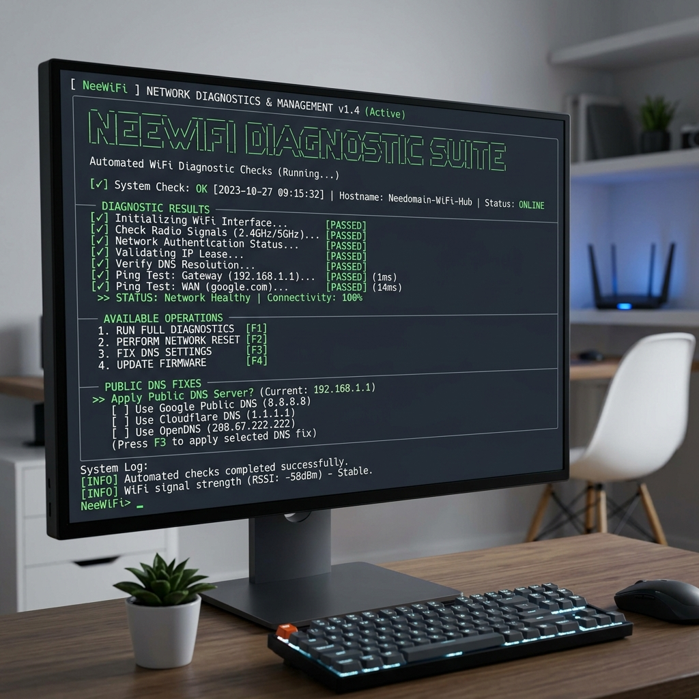
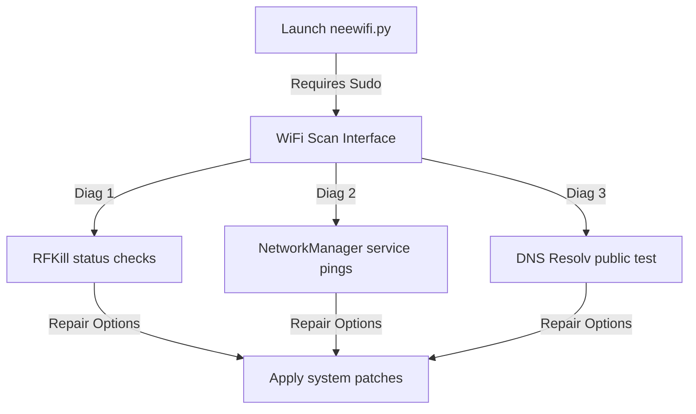

# NeeWiFi troubleshooter: Setup & Troubleshooting Guide

This guide details installation, root privilege setup, and network interface repair procedures for **NeeWiFi**.

---

## 1. Visual Overview & Flow

### NeeWiFi Diagnostic Console


### Diagnostics Pipeline Flowchart


---

## 2. Setup & Execution (Hindi + English)

### Step 1: Clone the Repository (Download karein)
```bash
git clone https://github.com/Neeshant01/nee-wifi-fixer.git
cd nee-wifi-fixer
```

### Step 2: Install UI Library (Setup karein)
Since this script uses CLI UI modules, ensure you have the `rich` library installed:
```bash
pip install rich
```

### Step 3: Run with Administrative Privileges (Sudo se chalayein)
WiFi adapters and network services require root access to be restarted or unblocked. **Sudo** privileges are mandatory:
```bash
sudo python3 neewifi.py
```
> [!NOTE]
> Agar aapko `externally-managed-environment` error aati hai, toh aap apne active virtual environment (`venv`) ke custom Python runtime wrapper se script ko run kar sakte hain:
> ```bash
> sudo ./venv/bin/python neewifi.py
> ```

---

## 3. Common Troubleshooting Steps (Dikkat Aaye toh Fix)

### Error 1: "python3: command not found" or missing sudo
- **Cause:** Sudo environment strips standard user PATH configuration on some systems.
- **Fix:** Execute specifying the absolute path of Python or link it:
  - `sudo /usr/bin/python3 neewifi.py`

### Error 2: DNS Resolution repair fails to persist
- **Cause:** Local services (e.g. systemd-resolved) overwrite `/etc/resolv.conf` automatically on reboot.
- **Fix:** Open `/etc/resolv.conf` and lock it after running the repair (immutable attribute):
  - `sudo chattr +i /etc/resolv.conf`
